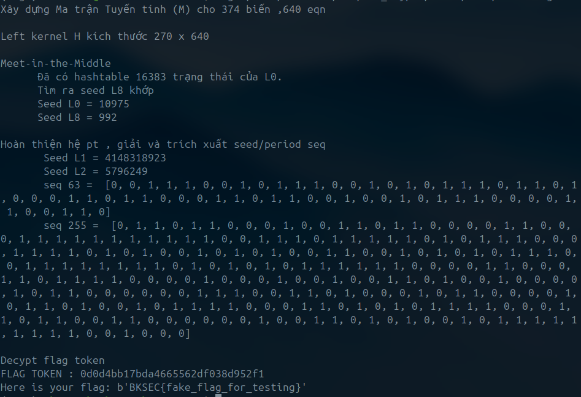

# LFSR

Category : Crypto

## Challenge overview 

Source code 

```python
import secrets
import threading
import sys
import os

def kill_switch():
    print("Time expired!")
    sys.exit()

SECRET_FLAG = os.environ.get("FLAG", "BKSEC{REDEACT}").encode()

Ns = [14, 32, 24, 48, 8, 8, 8, 8, 10]
MASKS = [1959, 3487505359, 12175963, 144894747199363, 39, 101, 99, 43, 579]
Filters = [
    43673535323473607050899647551732188151,
    69474900172976843852504521249820447513188207961992185137442753975916133181030,
    28448620439946980695145546319125628439828158154718599921182092785732019632576,
    16097126481514198260930631821805544393127389525416543962503447728744965087216,
    7283664602255916497455724627182983825601943018950061893835110648753003906240,
    55629484047984633706625341811769132818865100775829362141410613259552042519543,
    4239659866847353140850509664106411172999885587987448627237497059999417835603,
    106379335904610565198575784689340408012917012758379923896044369424798179675586
]

extract = lambda x,b: sum(((x >> p) & 1) << i for i, p in enumerate(b))
blur = lambda x,i: (Filters[i] >> x) & 1

class LFSR:
    def __init__(self, n, key, mask):
        self.n = n
        self.state = key & ((1 << n) - 1)
        self.mask = mask

    def __call__(self):
        b = self.state & 1
        self.state = (self.state >> 1) | (
            ((self.state & self.mask).bit_count() & 1) << (self.n - 1)
        )
        return b

class Cipher:
    def __init__(self, key):
        self.lfsrs = []
        for i in range(len(Ns)):
            self.lfsrs.append(LFSR(Ns[i], key, MASKS[i]))
            key >>= Ns[i]

    def bit(self):
        x = blur(extract(self.lfsrs[0].state, [5, 9, 1, 0, 4, 11, 13]), 0)
        y = self.lfsrs[1].state & 1
        z = blur(extract(self.lfsrs[2].state, [20, 2, 16, 11, 1, 23, 22, 8]), 1)
        w = blur(extract(self.lfsrs[3].state, [1, 46, 21, 7, 43, 0, 27, 39]), 2)
        v = blur(extract(self.lfsrs[4].state, [1, 3, 7, 4, 5, 0, 6, 2]), 3)
        u = blur(self.lfsrs[5].state, 4) ^ blur(self.lfsrs[6].state, 5) ^ blur(self.lfsrs[7].state, 6)
        t = blur(extract(self.lfsrs[8].state, [5, 8, 9, 3, 1, 0, 2, 4]), 7)
        for lfsr in self.lfsrs: lfsr()
        return x ^ y ^ z ^ w ^ v ^ u ^ t

    def stream(self):
        while True:
            b = 0
            for i in reversed(range(8)):
                b |= self.bit() << i
            yield b

    def encrypt(self, pt: bytes):
        return bytes([x ^ y for x, y in zip(pt, self.stream())])

key = secrets.randbits(160)
cipher = Cipher(key)
tk = secrets.token_bytes(15)
print("Token:", tk.hex())
time_guard = threading.Timer(60, kill_switch) 
time_guard.start()
print("ct:", cipher.encrypt(b"\x00"*80+tk).hex())
if input("Gimme Token: ") == tk.hex():
    print("Here is your flag:", SECRET_FLAG)
```


Thử thách cho 1 hệ mã hóa Cipher kết hợp 9 bộ LFSR với độ dài khác nhau với 

Mỗi lfsr (class `LFSR`) gồm :
- state: Trạng thái hiện tại của thanh ghi.
- mask: Xác định các vị trí (taps) để thực hiện phép XOR nhằm tạo ra bit feedback.
- chu kì của các bộ lfsr này sẽ tạo bit feed back như truyền thống

    

Main cipher (class `Cipher`) gộp các lfst tạo keystream phi tuyến tính (hàm bit())

- extract(x, b) : Trích xuất các bit tại các vị trí cụ thể b từ state x để tạo thành một số nguyên mới.
- blur(x, i) : Sử dụng số nguyên vừa trích xuất làm chỉ số (index) để lấy một bit từ danh sách Filters.

- với mỗi bộ lfsr tại 1 clock với state tương ứng sẽ thông qua các các hàm này để trích xúât ra một bit tương ứng để tham giá xor tạo feedforward bit ==> Keystream có tính phi tuyến 

Main challenge thì server sẽ encrypt 1 token và gửi ta ciphertext , nhiệm vụ của ta là decrypt ra token và gửi về cho server để lấy flag 


##  Quan sát challenge & hệ mã 

Known plaintext attack: server chèn 80 bytes 00 đầu vào token trước khi giải mã.
Với mật mã dòng (plaintext xor keystream) , 80 bytes đầu của ciphertext chính là của keystream


=> Ta có thể lập 1 hệ phương trình 640 ẩn.
Nếu ta có thể biểu diễn được feed forward của lfsr bằng 1 quan hệ tuyến tính giữa các biến bit
=> ta có thể giải hệ phương trình tuyến tính bằng Gauss

### Quan sát chu kì của các bộ lfsr

Có state của các bộ lfsr , tôi sẽ tính đa thức đặc trưng và chu kì của chúng 

```python
import time

Ns = [14, 32, 24, 48, 8, 8, 8, 8, 10]
MASKS = [1959, 3487505359, 12175963, 144894747199363, 39, 101, 99, 43, 579]

def simulate_period(n, mask, timeout=10):
    start_state = 1
    state = start_state
    period = 0
    start_time = time.time()
    
    while True:
        state = (state >> 1) | (((state & mask).bit_count() & 1) << (n - 1))
        period += 1
        
        if state == start_state:
            return period
            
        #  Chỉ check thời gian mỗi 100.000 vòng lặp
        if period % 100000 == 0:
            if time.time() - start_time > timeout:
                return f"Timeout, Đã chạy được {period} bước"


for i, (n, mask) in enumerate(zip(Ns, MASKS)):
    print(f"LFSR {i} (N={n:<2}) ", end=" ", flush=True)
    actual_period = simulate_period(n, mask, 10)
    print(f" => Chu kỳ: {actual_period}")
```

```
LFSR 0 (N=14)   => Chu kỳ: 16383
LFSR 1 (N=32)   => Chu kỳ: Timeout, Đã chạy được 34800000 bước
LFSR 2 (N=24)   => Chu kỳ: 16646017
LFSR 3 (N=48)   => Chu kỳ: 63
LFSR 4 (N=8 )   => Chu kỳ: 63
LFSR 5 (N=8 )   => Chu kỳ: 255
LFSR 6 (N=8 )   => Chu kỳ: 255
LFSR 7 (N=8 )   => Chu kỳ: 255
LFSR 8 (N=10)   => Chu kỳ: 1023
```


   

Ta thấy **lfsr3 và lfsr4** đều có chu kì là 63 => bit w , bit u có chu kì là 63 => bit w⊕v có chu kì là 63 => các bit w⊕v tạo thành chu kì f0, f1, … , f63   => Tạo thành 63 biến trong hệ phương trình 640 ẩn
vì tại mỗi clock thì 1 trong các biến này sẽ xor tạo key bit

 
Tương tự với **lfsr5 ,6,7** thì bit u có chu kì là 255  , tạo thành 255 biến trong hệ


### Biểu diễn đại số cho feedforward của các lfsr

Các con số khổng lồ trong mảng Filters trông có vẻ ngẫu nhiên. nhưng thực chất chúng chính là Bảng chân trị (Truth Table) .Khi hàm extract ghép 8 bit lại thành số nguyên X => `(Filters[i] >> X) & 1` chính là hành động tra cứu bit thứ X . Biến đổi Möbius (Fast Algebraic Transform) giúp chuyển bảng chân trị sang đa thức đại số

```python
def generate_anf(lfsr_idx, filter_val, extract_positions):
    k = len(extract_positions)
    tt = [(filter_val >> i) & 1 for i in range(1 << k)]
    anf = list(tt)
    for i in range(k):
        for j in range(1 << k):
            if (j & (1 << i)) != 0:
                anf[j] ^= anf[j ^ (1 << i)]
    terms = []
    if anf[0] == 1:
        terms.append("1")
    degree = 0
    for j in range(1, 1 << k):
        if anf[j] == 1:
            term_vars = []
            current_degree = bin(j).count('1')
            degree = max(degree, current_degree)
            for bit_idx in range(k):
                if (j >> bit_idx) & 1:
                    state_pos = extract_positions[bit_idx]
                    term_vars.append(f"s_{state_pos}")
            terms.append(" * ".join(term_vars))
    if not terms:
        equation = "0"
    else:
        equation = " + ".join(terms)
    print(f"[*] LFSR {lfsr_idx}")
    print(f"Degree: {degree}")
    print(f"f(S) = {equation}\n")
```

chạy code sẽ ra kết quả với lfsr 2 là hoàn toàn tuyến tính 

```
[*] LFSR 2
Degree: 1
f(S) = s_20 + s_2 + s_1 + s_23 + s_8
```

Feedforward của lfsr 2 có thể biểu diễn tuyến tính , ta sẽ thêm 24 ẩn bit của lfsr 2 vào hệ phương trình

Ngoài ra lfsr 1 implement theo cách chuẩn của lfsr tức là cũng tuyến tính . Ta sẽ thêm 32 ẩn bit vào hệ phương trình

### Hệ đã xây được 
Ta có 1 hệ gồm 640 phương trình với 374 ẩn số bao gồm:
- 32 ẩn của hệ LFSR 1 ($x_{1} \rightarrow x_{32}$)
- 24 ẩn của hệ LFSR 2 ($x_{33} \rightarrow x_{56}$)
- 63 ẩn của hệ LFSR 3 và 4 ($x_{57} \rightarrow x_{119}$)
- 255 ẩn của hệ LFSR 5, 6, 7 ($x_{120} \rightarrow x_{374}$)

Với mỗi clock i, hệ phương trình sẽ có dạng : $p_1x_1 + ⋯ + p_{32}x_{32} + p_{33}x_{33} + ⋯ + p_{374}x_{374} = a_i$ . Ta chỉ cần mô phỏng lại cipher để xác định hệ số của các ẩn tại từng clock 


## Xử lí phi tuyến 
Điều khó khăn ở đây là ta hoàn toàn ko biết RHS của hệ vì còn vướng Lfsr 0 và 8, biểu thức của 2 hệ này phi tuyến và nhiều ẩn khiến cho việc đưa vào hệ gần như ko thể . Tôi nghĩ đến việc brute 2 initial state của LFSR 0 và LFSR 8 còn lại, gen stream bit $x⊕s$ của 2 bộ đó qua 640 clock và XOR với keystream sinh ra stream $a_1, … , a_{640}$ . Case brute đúng thì hệ sẽ có nghiệm , tuy nhiên ta phải đối mặt với bài toán về thời gian . LFSR 0 có 14 bit state, LFSR 8 có 10 bit state => để đoán 24 bit sẽ có 16 triệu trường hợp, 16 triệu lần giải hệ . Implement của tôi cho thấy cần vài tiếng để hoàn thành việc này . 


### Kỹ thuật Meet-in-the-Middle 


Vậy nên để tối ưu hóa, ta sử dụng kỹ thuật Meet-in-the-Middle: Với $K$ là keystream (640), $M$ là ma trận của hệ (640×374), $X$ là vector nghiệm (374), $L_0$ là stream của LFSR 0, $L_8$ là stream của LFSR 8, ta có: 
$$K = (M ⋅ X) ⊕ (L0 ⊕ L8)$$

- Ta tính $H$ là left kernel của $M$: ($H ⋅ M = 0$) 

- Nhân 2 vế pt trên với $H$:
$$
H ⋅ K = H ⋅ L_0 ⊕ H ⋅ L_8 ⟺ H ⋅ L_0 = H ⋅ K ⊕ H ⋅ L_8 
$$

Từ đẳng thức trên , ta có thể  :
- Tạo 1 hash map, duyệt qua $2^{14}$ case của LFSR 0 và lưu vào bảng hash các giá trị $H ⋅ L_0$. 
- Sau đó brute qua $2^{10}$ case của LFSR 8, với mỗi case tính $H ⋅ K ⊕ H ⋅ L_8$ và kiểm tra xem có giá trị đó trong hash table không. Nếu có thì đó chính là 2 giá trị $L_0$ và $L_8$ cần tìm.

- Việc dùng bảng hash mỗi lần tìm kiếm chỉ tốn O(1), nhanh hơn rất nhiều so với việc brute cả 24 bit cùng lúc.

## Decryption
Khi đã có initial state của LFSR 0 và LFSR 8, ta chỉ cần gen ra RHS của hệ phương trình và giải hệ đó  .Với bộ nghiệm có được:
- Với bit u và w⊕v theo chu kì, ta chỉ cần gen tiếp các bit đó 
- Với LFSR 1 và 2, các nghiệm tương ứng chính là initial state của 2 hệ đó, chỉ cần gen tiếp stream của 2 hệ này.

Ta đã có thể gen toàn bộ keystream của hệ 9 LFSR và decrypt được phần token.


## Exploit

Dưới đây là toàn bộ code sage dùng để giải challenge

```python
from sage.all import *
from pwn import *

context.log_level = 'error'


HOST = "localhost"
PORT = 1337
r = remote(HOST, PORT)


r.recvuntil(b"ct: ")
ct_hex = r.recvline().strip().decode()


Ns = [14, 32, 24, 48, 8, 8, 8, 8, 10]
MASKS = [1959, 3487505359, 12175963, 144894747199363, 39, 101, 99, 43, 579]
FILTERS = [
    43673535323473607050899647551732188151,
    69474900172976843852504521249820447513188207961992185137442753975916133181030,
    28448620439946980695145546319125628439828158154718599921182092785732019632576,
    16097126481514198260930631821805544393127389525416543962503447728744965087216,
    7283664602255916497455724627182983825601943018950061893835110648753003906240,
    55629484047984633706625341811769132818865100775829362141410613259552042519543,
    4239659866847353140850509664106411172999885587987448627237497059999417835603,
    106379335904610565198575784689340408012917012758379923896044369424798179675586
]

E0 = [5, 9, 1, 0, 4, 11, 13]
E2 = [20, 2, 16, 11, 1, 23, 22, 8]
E8 = [5, 8, 9, 3, 1, 0, 2, 4]


ct_bytes = bytes.fromhex(ct_hex)
known_bits = [(byte >> i) & 1 for byte in ct_bytes[:80] for i in reversed(range(8))]
Z = vector(GF(2), known_bits)


def clock_sym(state, mask):
    fb = sum([state[i] for i in range(len(state)) if (mask >> i) & 1])
    return state[1:] + [fb]


print("Xây dựng Ma trận Tuyến tính (M) cho 374 biến ,640 eqn\n")
state_L1 = [vector(GF(2), 374, {i: 1}) for i in range(32)]
state_L2 = [vector(GF(2), 374, {32+i: 1}) for i in range(24)]

# Bóc tách cấu trúc tuyến tính của L2
tt2 = [(FILTERS[1] >> j) & 1 for j in range(256)]
C2_const = tt2[0]
C2_coeffs = [tt2[1<<i] ^^ C2_const for i in range(8)]

M = matrix(GF(2), 640, 374)
C2_vec = vector(GF(2), 640)

for i in range(640):
    row = vector(GF(2), 374)
    row += state_L1[0] # L1
    row += sum([C2_coeffs[k] * state_L2[E2[k]] for k in range(8)]) # L2
    C2_vec[i] = C2_const
    row[56 + (i % 63)] = 1 # V63
    row[119 + (i % 255)] = 1 # V255
    
    M[i] = row
    state_L1 = clock_sym(state_L1, MASKS[1])
    state_L2 = clock_sym(state_L2, MASKS[2])


H = M.left_kernel().basis_matrix()
print(f"Left kernel H kích thước {H.nrows()} x {H.ncols()}\n")


# to gen feed forward stream for lfsr 0,8 and 1,2 
def gen_lfsr_stream(n, mask, filter_val, ext_pos, seed):
    state = seed
    stream = vector(GF(2), 640)
    for i in range(640):
        idx = 0
        for j, p in enumerate(ext_pos):
            if (state >> p) & 1: idx |= (1 << j)
        stream[i] = (filter_val >> idx) & 1
        fb = bin(state & mask).count('1') & 1
        state = (state >> 1) | (fb << (n - 1))
    return stream


print("Meet-in-the-Middle")
hash_L0 = {}
for seed0 in range(1, 1 << 14):
    stream0 = gen_lfsr_stream(14, MASKS[0], FILTERS[0], E0, seed0)
    Y0 = H * stream0
    hash_L0[tuple(Y0)] = seed0
print(f"      Đã có hashtable {len(hash_L0)} trạng thái của L0.")


seed_L0, seed_L8 = None, None
T = H * (Z + C2_vec)
for seed8 in range(1, 1 << 10):
    stream8 = gen_lfsr_stream(10, MASKS[8], FILTERS[7], E8, seed8)
    Y8 = H * stream8
    target_Y0 = Y8 + T
    
    if tuple(target_Y0) in hash_L0:
        seed_L0 = hash_L0[tuple(target_Y0)]
        seed_L8 = seed8
        print(f"      Tìm ra seed L8 khớp" )
        print(f"      Seed L0 = {seed_L0}")
        print(f"      Seed L8 = {seed_L8}\n")
        break


print("Hoàn thiện hệ pt , giải và trích xuất seed/period seq")

stream0 = gen_lfsr_stream(14, MASKS[0], FILTERS[0], E0, seed_L0)
stream8 = gen_lfsr_stream(10, MASKS[8], FILTERS[7], E8, seed_L8)

RHS = Z + C2_vec + stream0 + stream8
    
try:
    X = M.solve_right(RHS)

    seed_L1 = sum(int(X[i]) << i for i in range(32))
    seed_L2 = sum(int(X[32 + i]) << i for i in range(24))
    seq_63 = [int(X[56 + i]) for i in range(63)]
    seq_255 = [int(X[119 + i]) for i in range(255)]
    
    print(f"       Seed L1 = {seed_L1}")
    print(f"       Seed L2 = {seed_L2}")
    print("       seq 63 = ",seq_63)
    print("       seq 255 = ",seq_255)
    print()

except ValueError:
    print("Hệ pt vô nghiệm")
    sys.exit()


print("Decypt flag token")

extract = lambda x,b: sum(((int(x) >> p) & 1) << i for i, p in enumerate(b))
blur = lambda x,i: (FILTERS[i] >> int(x)) & 1

class LFSR:
    def __init__(self, n, key, mask):
        self.n = n
        self.state = int(key) & ((1 << n) - 1)
        self.mask = int(mask)

    def __call__(self):
        b = self.state & 1
        fb = int(self.state & self.mask).bit_count() & 1
        self.state = (self.state >> 1) | (fb << (self.n - 1))
        return b

class Cipher:
    def __init__(self, s0, s1, s2, s8, seq63, seq255):
        self.lfsr0 = LFSR(Ns[0], s0, MASKS[0])
        self.lfsr1 = LFSR(Ns[1], s1, MASKS[1])
        self.lfsr2 = LFSR(Ns[2], s2, MASKS[2])
        self.lfsr8 = LFSR(Ns[8], s8, MASKS[8])
        
        self.seq63 = seq63
        self.seq255 = seq255
        self.clock = 0

    def bit(self):
        x = blur(extract(self.lfsr0.state, E0), 0)
        y = self.lfsr1.state & 1
        z = blur(extract(self.lfsr2.state, E2), 1)
        t = blur(extract(self.lfsr8.state, E8), 7)
        
        w_v = int(self.seq63[self.clock % 63])
        u = int(self.seq255[self.clock % 255])
        
        self.lfsr0()
        self.lfsr1()
        self.lfsr2()
        self.lfsr8()
        self.clock += 1
        
        return x ^^ y ^^ z ^^ w_v ^^ u ^^ t

    def stream(self):
        while True:
            b = 0
            for i in reversed(range(8)):
                b |= self.bit() << i
            yield b

    def decrypt(self, ct: bytes):
        return bytes([int(c) ^^ int(k) for c, k in zip(ct, self.stream())])


cipher = Cipher(seed_L0, seed_L1, seed_L2, seed_L8, seq_63, seq_255)
decrypted_bytes = cipher.decrypt(ct_bytes)

token = decrypted_bytes[80:]
print(f"FLAG TOKEN : {token.hex()}")

r.recvuntil(b"Gimme Token: ")
r.sendline(token.hex().encode())
flag = r.recvall(timeout=5).decode().strip()
print(flag)
r.close()
```

