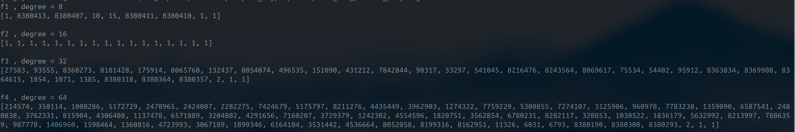
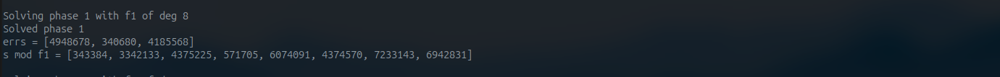
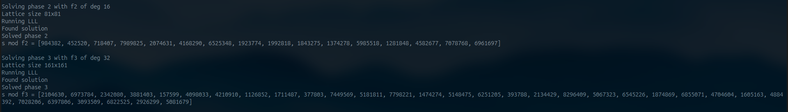
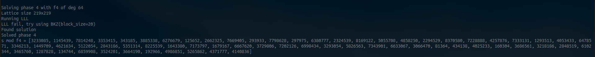
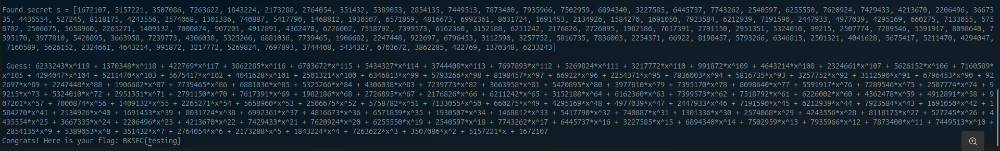

# Lord of the error ring 

- category : Crypto 
- Difficulty : Hard 

## 1. Challenge overview 

Source code 
```python 
import os
import random
import ast

proof.arithmetic(False)

flag = os.environ.get("FLAG","BKSEC{testing}")
p = 8380417
F = GF(p)
R.<x> = F[]

fs = []
degree = [8,16,32,64]
errs = random.sample(range(p), 3)
print(errs)

for d in degree:
    f = R.irreducible_element(d)
    if f not in fs:
        fs.append(f)

f = prod(fs)

def parse_poly(user_in):
    coeffs = ast.literal_eval(user_in)
    if not isinstance(coeffs, (list, tuple)):
        raise ValueError
    if not all(isinstance(c, int) for c in coeffs):
        raise ValueError
    return R([c % p for c in coeffs])


def poly_crt(res, fs):
    M = prod(fs)
    a = R(0)
    for i, fi in enumerate(fs):
        Mi = M // fi
        Ni = Mi.inverse_mod(fi)   
        a += res[i] * Mi * Ni
    return a % M
    
def poly_sample(lb, ub):
    es = [R([random.randint(lb,ub) for _ in range(d)]) for d in degree]
    
    return poly_crt(es, fs)

def error_sample(errs):
    es = [R([random.choice(errs) for _ in range(d)]) for d in degree]
    
    return poly_crt(es, fs)


print("Welcome to RLWE challenge!")
print("I will let u sample at most 10 samples this time  :DDDDD")
print("num sample:")

num_sample = int(input("> "))
if num_sample > 10:
    print("You are too greedy !!!")
    exit()

a_s = [poly_sample(0, p - 1) for _ in range(num_sample)]
s = poly_sample(0, p - 1)
e_s = [error_sample(errs) for _ in range(num_sample)]

samples = [(list(a % f), list((a * s + e) % f)) for a, e in zip(a_s, e_s)]

print("Here is your polynomial f:")
print(list(f))
print("Here are your samples:")
print(samples)


print("Submit your guess for my secret :<<<<")

try:
    guess = R(parse_poly(input("> ")))
    print('Guess:', guess)
    if guess == s:
        print("Congrats! Here is your flag: " + flag)
except:
    print("Don't be that desperate :v")
    exit()
```


Ta có thể thấy hệ mã trong challenge là 1 biến thể base trên Ring LWE 

- hệ mã RLWE được xây trên vành đa thức $R[x] = Z_p[x]/f$ với p  = 8380417 . Thay vì dùng đa thức $f = x^n + 1$ thì hệ mã chọn ra 4 đa thức bất khả quy $f_i$ với bậc lần lượt là 8,16,32,64 và ghép lại $f = f_1.f_2.f_3.f_4$ .Thay vì chọn nhiễu $e$ nhỏ như là RLWE thông thường , chal random 4 vecto nhiễu thành phần trên $Z_p[x]/f_i$ sau đó ghép lại bằng CRT để thành $e\pmod {f}$ , và các hệ số của mỗi đa thức $e_i$ được chọn từ 1 trong 3 số được random trên $Z_q$ của tập  `errs`
- Về phần thử thách , dựa trên công thức $b = as + e \pmod f$ của RLWE , chal gen khóa bí mật $s$ sau đó random ra nhiều nhất 10 cặp đa thức ($a_i,e_i$) để  tính ra $b_i$ . Server sẽ cho ta 10 sample $(a_i,b_i)$ này và bắt ta khôi phục lại secret $s$ để lấy được flag 


## Attack Idea 

Ta sẽ tận dụng các điểm khác thường của hệ mã này so với bài toán RLWE gốc để tìm hướng khai thác . Dễ thấy là ta có thể tìm các giá trị $s \pmod{f_i}$ trên các cành đa thức nhỏ hơn sau đó construct lại thành $s \pmod{f}$ bằng CRT . Tiếp theo là việc ko dùng random nhiễu nhỏ mà các nhiễu thành phần $e \pmod{f_i}$ có các hệ số chỉ nhận 1 trong 3 giá trị . 


Trước tiên thì ta cần phải factor được đa thức $f(x)$ mà server gửi đến thành 4 đa thức thành phần , việc này khác dễ dàng khi dùng hàm factor trong sagemath . Hơn nữa thì như source code server thì hàm random ra các đa thức con là deterministic , tức là các $f_i(x)$ cũng như $f(x)$ là cố định , ta ko cần đợi $f$ từ server . 

```python
p = 8380417
F = GF(p)
R.<x> = F[]

f_coeffs = [2020240, 265213, 8152448, 1535330, 2302708, 188378, 4856268, 706694, 3888509, 892985, 7354552, 8172644, 1821287, 6012562, 6214552, 4620009, 269958, 2713660, 6902035, 3946856, 6610444, 6339, 4376878, 2650537, 6107091, 7884244, 8134050, 3585005, 8215254, 3058088, 4326325, 5780968, 5620643, 2045529, 1853649, 5820996, 7252971, 942616, 4123236, 1999542, 29601, 1823190, 7009514, 7392312, 6110635, 662596, 7578109, 7314550, 4536439, 2713935, 65615, 433806, 7852665, 8277309, 4578221, 7331417, 8115130, 1817320, 5330933, 2820207, 6925175, 5269501, 6986417, 4270840, 1541104, 5120143, 7500981, 7954515, 6482335, 4292987, 6993323, 2535234, 3576325, 1074488, 201808, 2324864, 2397710, 2824968, 1576746, 4847844, 2163136, 6229964, 3964077, 6820186, 3800330, 1077806, 7453108, 779773, 7713008, 4192884, 2125242, 2268313, 813588, 2250814, 5876952, 7155218, 2157270, 3818794, 5683869, 5492251, 3832114, 210892, 8145760, 6901089, 4085414, 7192824, 1194351, 4847602, 2522996, 5620900, 4856679, 7441652, 56020, 65652, 17006, 8379720, 8379664, 8380226, 4, 4, 1]
f = R(f_coeffs)

factors = f.factor()

fs = [fac[0] for fac in factors]
fs.sort(key=lambda poly: poly.degree())

for i, fi in enumerate(fs):
    print(f"f{i+1} , degree =", fi.degree())
    print(list(fi))
    print()
```


Về phần implement , ta sẽ phải tính toán trên từng hệ số của đa thức , vậy nên tốt nhất là nên chuyển đổi đa thức thành vecto cũng như phép nhân đa thức thành phép nhân với ma trận để dễ lập hệ . Sau đây là hàm để biến phép nhân với đa thức $a(x)$ thành nhân ma trận A

```python
# convert mul a(x) to mul matrix A 
def poly_to_matrix(a_poly, mod_poly, degree):
    cols = []
    for j in range(degree):
        term = (a_poly * (x**j)) % mod_poly
        c = term.list()
        c += [0] * (degree - len(c))
        cols.append(c)
    return matrix(F, cols).transpose()
```


## Phase 1 : s mod f1 và errs


Để khôi phục lại $s_1 = s \pmod {f_1}$ , đương nhiên đầu tiên ta sẽ đi từ đa thức $f_1(x)$ nhỏ nhất với bậc 8 . Đa thức nhiễu là 1 thách thức lớn , tuy nhiên với việc từng hệ số trong đa thức chỉ có 3 giá trị có thể  trong tập `errs`, ta đặt ẩn 3 giá trị này là $c_1,c_2,c_3$ => mỗi vecto nhiễu ( 8x1) là 1 pattern và ta có thể nghĩ đến việc brute force pattern này chỉ với hơn 3000 case . Chiến lược tìm $c_1,c_2,c_3$ diễn ra như sau : Ta có 10 sample $(a_i,b_i)$ , ta sẽ brute force pattern của $e_0$ . Với mỗi case pattern của $e_0$ ta sẽ:

- Biễu diễn vecto $s_1$ qua công thức $s_1 = A_0^{-1} \cdot (b_0 - e_0) \pmod p$ , khi này thì mỗi hệ số $s_1[i]$ của vecto là bậc nhất của $c_1,c_2,c_3$

- Tiếp theo thì với các sample $(a_i,b_i)$ còn lại ta có $$e_i = b_i - A_i \cdot s_1(c_1, c_2, c_3) \pmod{f_1}$$
    - Khi này thì mỗi hệ số của vecto $e_i$ là bậc nhất của $c_1,c_2,c_3$ 
    - Hơn nữa với việc mỗi hệ số trong vecto $e_i$ chỉ có 1 trong 3 giá trị , điều này có nghĩa là $(e_{i, k} - c_1)(e_{i, k} - c_2)(e_{i, k} - c_3) = 0 \pmod p$ => Dễ thấy đây là 1 pt bậc 3 3 ẩn $c_1,c_2,c_3$
    - Một phương trình đa thức bậc 3 với 3 ẩn số chỉ có tổng cộng 20 đơn thức  $1, c_1, c_2, c_3, c_1^2, c_1c_2, \dots, c_3^3$  => Ta có thể tuyến tính hóa thành 20 ẩn 
- Từ idea này , với mỗi sample i , ta có thể lập được 8 phương trình $(e_{i, k} - c_1)(e_{i, k} - c_2)(e_{i, k} - c_3) = 0 \pmod p$ với mỗi hệ số  $e_{i, k}$ , mỗi pt 20 ẩn => Ta chỉ cần 4 sample để lập thành hệ 32x20 quá đủ để giải ra được $c_1,c_2,c_3$ . 

Khi mà pattern đó là đúng , hệ sẽ có nghiệm và ta sẽ có đc tập `errs` , từ đó khôi phục $s_1$ dễ dàng . Dưới đây là implement của phase 1

```python
# SOLVE PHASE1 
def solve_phase1(fi, degree, samples):
    print(f"\nSolving phase 1 with f1 of deg {degree}")

    samples_5 = samples[:5]
    
    A_matrices = []
    B_vectors = []
    for a_list, b_list in samples_5:
        A_matrices.append(poly_to_matrix(R(a_list) % fi, fi, degree))
        b_coeffs = (R(b_list) % fi).list()
        B_vectors.append(vector(F, b_coeffs + [0] * (degree - len(b_coeffs))))

    A0_inv = A_matrices[0].inverse()
    v0 = A0_inv * B_vectors[0]
    M0 = A0_inv
    
    T_matrices = [A_matrices[i] * M0 for i in range(1, 5)]
    V_vectors = [B_vectors[i] - A_matrices[i] * v0 for i in range(1, 5)]

    PR.<c1, c2, c3> = PolynomialRing(F, 3)
    monomials = [PR(1), c1, c2, c3, c1^2, c1*c2, c1*c3, c2^2, c2*c3, c3^2,c1^3, c1^2*c2, c1^2*c3, c1*c2^2, c1*c2*c3, c1*c3^2,c2^3, c2^2*c3, c2*c3^2, c3^3]
    C_var = [c1, c2, c3]

    patterns = [p for p in itertools.product([0, 1, 2], repeat=degree) 
                    if set(p) == {0, 1, 2} and p.index(0) < p.index(1) and p.index(1) < p.index(2)]

    errs = []
    s1 = []
    
    for pat in patterns:
        e0_sym = vector(PR, [C_var[idx] for idx in pat])
        equations = []
        for i in range(4):
            ei_sym = V_vectors[i-1] + T_matrices[i-1] * e0_sym
            for k in range(degree):
                E = ei_sym[k]
                equations.append((E - c1) * (E - c2) * (E - c3))
                
        M_lin = matrix(F, 32, 20)
        for row_idx, eq in enumerate(equations):
            for col_idx, mon in enumerate(monomials):
                M_lin[row_idx, col_idx] = eq.monomial_coefficient(mon)
                

        ker = M_lin.right_kernel()
        if ker.dimension() > 0:
            for vec in ker.basis():
                if vec[0] != 0:
                    vec = vec / vec[0]
                    ans_c1, ans_c2, ans_c3 = vec[1], vec[2], vec[3]
                    
                    # check valid solution of c1, c2, c3
                    if vec[4] == ans_c1**2 and vec[7] == ans_c2**2:
                        errs = [int(ans_c1), int(ans_c2), int(ans_c3)]
                        e0_val = vector(F, [ans_c1 if idx==0 else (ans_c2 if idx==1 else ans_c3) for idx in pat])
                        
                        s1_val = M0 * (B_vectors[0] - e0_val)
                        s1 = list(s1_val) +  [0] * (degree - len(list(s1_val))) 
                        break
        if errs: 
            break

    if not errs:
        print("Can't find errs and s mod f1")
        sys.exit(1)
    
    print("Solved phase 1")
    print(f"errs = {errs}")
    print(f"s mod f1 = {s1}")
    
    return errs, s1
```
```python
errs,s1 = solve_phase1(f1, 8, samples)
```



## Phase 2,3,4 

Việc có thể tìm ra $s \pmod {f_1}$ và tìm ra tập `errs` là 1 bước tiến lớn của bài toán , tuy nhiên thì việc tìm $s \pmod {f_i}$ trên các vành đa thức với $f_i$ càng lớn (16,32,64) vẫn là thử thách khó nhằn . Việc đi từ Đi từ $f$ bậc thấp lên $f$ bậc cao dường như là không thể  vì định lý Số dư Trung Hoa đảm bảo các phần dư $s \pmod{f_i}$ là hoàn toàn độc lập về mặt đại số => $s \pmod{f_8}$ không rò rỉ bất kỳ một bit thông tin nào về $s \pmod{f_{64}}$ . Tôi cũng ko thể tìm ra được cách lập hệ nào để có thể giải luôn được ra vecto $s$ cũng như các vecto nhiễu . với $f_2$ có bậc 16 , ta vẫn có thể brute force 1 vector nhiễu , tuy nhiên việc này sẽ thực sự bất khả thi với bậc 32 và 64 . Tôi cũng đã tìm cách tôi ưu cân bằng giữa brute force và giải hệ nhưng việc càng lấy nhiều sample , có nhiều phương trình đồng nghĩa với số ẩn từ nhiễu $e_i$ sẽ tăng lên theo hoàn toàn dập tắt ý tưởng . Vậy nên idea cuối cùng là cố đưa bài toán về nghiệm nhỏ => dùng lattice và các thuật toán lattice reduction để giải nghiệm . Chi tiết cách làm sẽ như sau , tôi sẽ lấy ví dụ giải $f_3$ bậc 32

- Mỗi hệ số $e_{i,k}$ trong vecto $e_i$ có thể biễu diễn 
    $$e_{i,k} = c_1 + (c_2 - c_1)x_{i,k} + (c_3 - c_1)y_{i,k}$$
    $$<=>e_{i,k} = c_1 + \Delta _2 . x_{i,k} + \Delta _3 . y_{i,k}$$
    - với $x_{i,k}$ và $y_{i,k}$ là các biến thuộc $\{0, 1\}$ (và không  đồng thời bằng 1) => Ta có các biến x,y này là nghiệm nhỏ 

- để luôn các biến của vecto $s_3$ vào sẽ gây ra chênh lệnh độ lớn giữa các biến , ta sẽ phải tìm cách để bỏ ra khỏi hệ , và tôi sử dụng left kernel để làm điều này . Ta lấy Sample 0 và Sample 1 (tổng cộng 64 hệ số). Biểu diễn dưới dạng ma trận:
    $$\begin{bmatrix} \vec{b_0} \\ \vec{b_1} \end{bmatrix} = \begin{bmatrix} A_0 \\ A_1 \end{bmatrix} \cdot \vec{s} + \begin{bmatrix} \vec{e_0} \\ \vec{e_1} \end{bmatrix} \pmod p$$

- Ta tính left kernel $L$ của ma trận $\begin{bmatrix} A_0 \\ A_1 \end{bmatrix}$ , sau đó nhân cả 2 vế của pt trên với $L$:
    $$L \cdot \begin{bmatrix} \vec{b_0} \\ \vec{b_1} \end{bmatrix} \equiv L \cdot \begin{bmatrix} \vec{e_0} \\ \vec{e_1} \end{bmatrix} \pmod p$$

- $\begin{bmatrix} A_0 \\ A_1 \end{bmatrix}$ có rank là 32 => theo lí thuyết $L$ sẽ có 64 - 32 = 32 vecto  hàng => $L$ có size 32x64 => $L \cdot \begin{bmatrix} \vec{b_0} \\ \vec{b_1} \end{bmatrix}$ là vecto 32x1 => Ta có 1 hệ 32 phương trình 128 ẩn (mỗi $e_{i,k}$ <=> 1 ẩn $x$ + 1 ẩn $y$)=> Đây chính là bài toán lattice họ knapsack, multi modular subset sum . Ta có thể dùng template sau để giải 

    ```python
    # MULTI MODULAR KNAPSACK SOLVER (FOR PHASE 2,3,4)

    # Extract and validate the solution vector from the reduced basis
    def extract_and_validate(reduced_basis, num_var, num_eq, A, S, p):
        for row in reduced_basis:
            if all(row[num_var + 1 + j] == 0 for j in range(num_eq)):
                if row[num_var] == -1/2:
                    e_cand = [int(val + 1/2) for val in row[:num_var]]
                elif row[num_var] == 1/2:
                    e_cand = [int(1/2 - val) for val in row[:num_var]]
                else:
                    continue
                
                if all(bit in [0, 1] for bit in e_cand):
                    valid = True
                    if all(e_cand[i] + e_cand[i + num_var//2] <= 1 for i in range(num_var//2)):
                        for j in range(num_eq):
                            if (sum(e_cand[i] * A[j][i] for i in range(num_var)) % p) != (S[j] % p):
                                valid = False
                                break
                    if valid:
                        return e_cand
        return None


    # Solve the multi modular knapsack problem (S = Ax (modp))
    def solve_multi_modular_subset_sum(A, S, p):
        num_eq = len(A)
        num_var = len(A[0])

        W = 2**100
        M = Matrix(QQ, num_var + num_eq + 1, num_var + num_eq + 1)
        
        for i in range(num_var):
            M[i, i] = 1                       
            for j in range(num_eq):
                M[i, num_var + 1 + j] = W * A[j][i]
                
        for j in range(num_eq):
            M[num_var + j, num_var + 1 + j] = W * p

        for i in range(num_var):
            M[num_var + num_eq, i] = 1/2                    
        M[num_var + num_eq, num_var] = 1/2
        
        for j in range(num_eq):
            M[num_var + num_eq, num_var + 1 + j] = W * S[j]
        
        print(f"Lattice size {M.nrows()}x{M.ncols()}")
        print("Running LLL")
        reduced_M = M.LLL()
        
        sol = extract_and_validate(reduced_M, num_var, num_eq, A, S, p)
        if sol:
            return sol
            
        else: 
            print("LLL fail, try using BKZ(block_size=20)")
            reduced_M = M.BKZ(block_size=20)
            return extract_and_validate(reduced_M, num_var, num_eq, A, S, p)
            
        return None
    ```
- Cuối cùng thì việc tìm lại vecto $s_3$ trở nên dễ dàng khi tìm được vecto nhiễu 

Khi implement , số phương trình của hệ cần được xem xét trước khi đưa vào LLL để tránh size lattice quá to , nhất là với $f_4$ . Ở vd trên với bậc 32 , tôi lấy hết 2 sample tạo thành $\begin{bmatrix} A_0 \\ A_1 \end{bmatrix}$ => số pt = số hàng ma trận  - rank ma trận = 32 => lattice size 161x161 . Tuy nhiên , với bậc 64 nếu lấy vả 2 sample , ta sẽ có 64 pt 256 ẩn dẫn đến size lattice là 321x321 quá lớn , vậy nên việc lấy 30 hàng của ma trận $A_1$ để hệ gồm 30 pt là hợp lí. 


```python
def solve_branch_lattice(phase ,fi, degree, samples, errs, num_eq):
    print(f"\nSolving phase {phase} with f{phase} of deg {degree}")
    
    a0_f = R(samples[0][0]) % fi
    b0_f = R(samples[0][1]) % fi
    a1_f = R(samples[1][0]) % fi
    b1_f = R(samples[1][1]) % fi

    c1, c2, c3 = errs[0], errs[1], errs[2]
    delta2 = (c2 - c1) % p
    delta3 = (c3 - c1) % p

    A0 = poly_to_matrix(a0_f, fi, degree)
    A1 = poly_to_matrix(a1_f, fi, degree)

    b0_vec = vector(F, b0_f.list() + [0] * (degree - len(b0_f.list())))
    b1_vec = vector(F, b1_f.list() + [0] * (degree - len(b1_f.list())))

    A1_sub = A1[:num_eq, :]
    b1_sub = b1_vec[:num_eq]

    A_big = block_matrix([[A0], [A1_sub]]) 
    b_big = vector(F, list(b0_vec) + list(b1_sub)) 

    L = A_big.left_kernel().basis_matrix() 

    c1_vec = vector(F, [c1] * (degree + num_eq))

    #targer vecto s of multi knapsack problem 
    s_target = L * b_big - L * c1_vec

    W_X = L * delta2 
    W_Y = L * delta3 

    # matrix of multi knapsack problem A_knap = W_X | W_Y
    A_knap = block_matrix([[W_X, W_Y]]) 

    A_list = [[int(A_knap[j, i]) for i in range(2 * (degree + num_eq))] for j in range(num_eq)]
    s_list = [int(val) for val in s_target]


    solution = solve_multi_modular_subset_sum(A_list, s_list, p)
    if solution:
        print(f"Found solution")
        X_0 = solution[:degree]
        Y_0 = solution[degree + num_eq : 2 * degree + num_eq]
        
        e0 = []
        for i in range(degree):
            val = (c1 + X_0[i] * delta2 + Y_0[i] * delta3) % p
            e0.append(val)
            
        s_vec = A0.inverse() * (b0_vec - vector(F, e0))
        s = list(s_vec) + [0] * (degree - len(list(s_vec)))
        print(f"Solved phase {phase}")
        print(f"s mod f{phase} =",s)
        return s
    else:
        print(f"Lattice fail")
        return None
```

Việc giải ra $s \pmod {f_2}$ và $s \pmod {f_3}$ diễn ra khá nhanh 

```python
s2 = solve_branch_lattice(2, f2, 16, samples, errs, num_eq=16)
s3 = solve_branch_lattice(3, f3, 32, samples, errs, num_eq=32)
```



Đến phase 4 , LLL chạy khá nhanh, tuy nhiên kết quả lại là no solution , tôi nhận ra rằng thuật toán LLL có thể ko hiệu quả trên lattice lớn . Vậy nên tôi đã backup dùng BKZ vốn hiệu quả hơn (và thời gian lâu hơn), và cuối cùng thì tôi đã có thể tìm dc $f_4$

```python
s4 = solve_branch_lattice(4, f4, 64, samples, errs, num_eq=30)
```



## Kết hợp thành s
Bước cuối cùng là từ $s_1,s_2,s_3,s_4$ kết hợp thành $s$ dùng CRT (code server cho sẵn)  , và gửi secret cho server để lấy flag 



